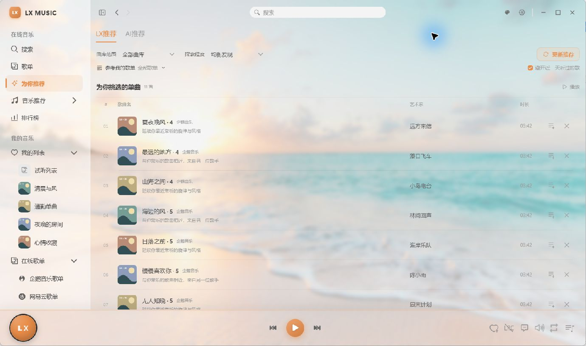
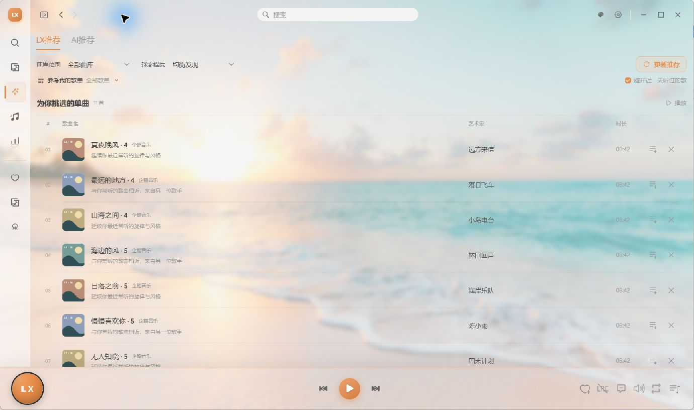
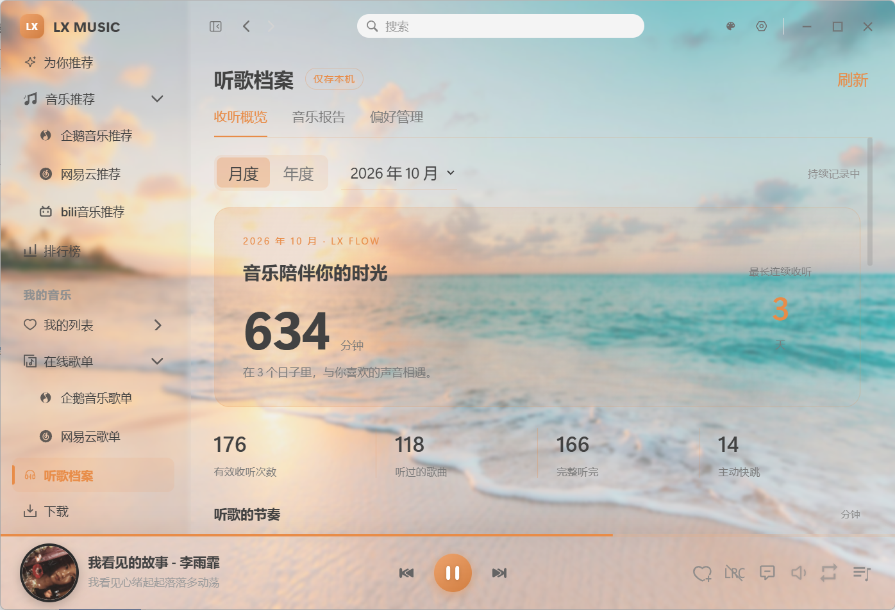

<h1 align="center">LX Flow Music</h1>

  
  

基于 LX Music Desktop 的个人使用修改版，当前最新版本为 3.3.0。支持 LX个性化推荐、AI推荐、Bilibili 音乐，以及企鹅音乐与网易云音乐的账号推荐和歌单联动。

## v3.3.0 更新亮点

- **图标侧栏**：收起后保留可点击的导航图标，歌单和平台推荐通过弹出列表选择。
- **本地听歌档案**：查看实际收听时长、有效收听、完播、主动快跳、常听歌曲与歌手。
- **月度与年度报告**：月底和年底自动整理，软件关闭期间错过的报告会在下次打开时补生成。
- **偏好管理**：暂停记录、选择是否用听歌习惯推荐、忽略或恢复单曲偏好，也可保留档案并重新学习口味。
- **精简存储**：明细保留最多 90 天、5,000 条，月报保留 36 个月，年报保留 10 年；只保存文字和数字，不额外保存音频、歌词、封面或报告图片。

查看[完整更新公告](https://github.com/eohh-zhou/lx-flow-music-desktop/releases/tag/v3.3.0)及[听歌档案说明](doc/listening.md)。

## 个人使用版说明

这是我基于 [LX Music Desktop](https://github.com/lyswhut/lx-music-desktop) 修改维护的个人使用版，并非原项目官方发行版。原项目的版权、许可和署名均保留在本仓库中；本项目同样遵循 Apache License 2.0。

原项目：<https://github.com/lyswhut/lx-music-desktop>

## 我增加和调整的功能

### 为你推荐

- LX推荐以「我的列表」歌单为基础，逐步结合近期完播、反复播放、实际收听时长和主动跳过记录，推荐歌单里没有的单曲。
- 可选择曲库范围、探索程度和参考歌单，支持不感兴趣反馈；每首参考歌曲在一次推荐的完整结果中最多带出两首，兼顾不同歌手和专辑。
- AI推荐可配置兼容模型接口，先规划多个搜索方向，再从真实曲库候选中筛选与排序；候选不足时适量补充检索，避免用不符合需求的歌曲凑数。可自行选择是否使用个人听歌偏好。
- 两种推荐均以单列歌曲列表展示本次全部合格结果，支持直接播放、加入歌单和不感兴趣反馈。
- 收听统计保存在本机；LX推荐不调用模型 API，AI推荐仅在手动生成时调用，打开页面和切换平台读取缓存。

### 听歌档案与音乐报告

- 在「我的音乐 → 听歌档案」查看本月或本年的收听时长、常听歌曲、常听歌手及收听节奏。
- 月报、年报自动归档，也能提前查看当前月份和年份的总结。
- 可暂停记录、调整收听偏好是否参与推荐、忽略单曲偏好或重置学习；统计与报告独立保留。
- 数据保存在本机，自动清理过期明细与报告，不额外缓存音频或报告图片。详见[听歌档案说明](doc/listening.md)。

### Bilibili 音乐

- 支持导入公开收藏夹、合集、系列与分 P 视频歌单，以及浏览热门和最新音乐合集。
- 内置 Bilibili 音频播放，并提供歌曲艺术家识别和歌词匹配。
- 企鹅音乐、网易云和 bili 音乐的平台推荐统一收纳在侧栏「音乐推荐」中。

### 企鹅音乐

- 左侧导航可直接进入企鹅音乐推荐，不必再翻到深层歌单页。
- 账号视图包含主页推荐、我的歌单、雷达推荐、推荐歌单、推荐新歌；「我的歌单」可浏览账号创建和收藏的歌单并在应用内播放。
- 独立企鹅音乐设置页：用登录窗口获取登录状态，不必手动粘贴 Cookie；登录信息只保存在本机。
- 「我的列表」右键「同步到企鹅音乐」，预览匹配结果后会复用已有同名歌单、补充缺少的歌曲；没有同名歌单时新建，不会删除已有歌曲或歌单。

### 网易云音乐

- 登录后可浏览账号创建和收藏的歌单。
- 支持每日推荐、私人 FM、推荐歌单、推荐新歌；当前播放歌曲会在列表和歌单封面显示节奏条，悬停可暂停或继续。
- 本地歌单可匹配后增量同步到网易云音乐，保留现有歌曲并按本地顺序排列。

### 界面与播放

- 左侧导航栏支持一键收起为可点击的图标栏，并记住上次状态；歌单和平台推荐可从弹出列表选择。
- 工具栏换肤按钮可立即切换当前皮肤，点哪个就用哪个；皮肤弹窗可单独调整左侧栏透明度、右侧栏透明度，以及左侧栏、右侧栏各自的毛玻璃强度。
- 提供多套纯色主题，以及雨天、黄昏海、极光、山湖、手绘原野、乡云等图片主题；壁纸会透过侧栏和列表，并保留可读的半透明底与较轻的毛玻璃。
- 搜索支持歌曲、歌单、歌手、专辑；可打开歌手详情查看歌曲和专辑。
- 播放栏提供六种进度条样式，默认接近网易云：圆形封面、居中控制按钮、全宽顶边进度条。
- 桌面歌词改为接近网易云的单行条：每次打开都在桌面顶部水平居中；悬停显示工具栏；贴到屏幕顶部时工具栏会移到歌词下方。
- 基本设置可选择字体和字号；窗口最小化、最大化、关闭按钮改为圆角矩形。
- Windows Setup 安装版可通过 GitHub Releases 在软件内检查、下载和安装后续更新。

### 运行与资源占用

- 歌单封面按需读取，侧栏收起或窗口隐藏时暂停后续封面加载。
- 推荐只读取歌曲身份与偏好所需的信息，继续完整排除「我的列表」里已有的歌曲。
- 在线歌单、排行榜、歌手资料及混响音效使用有上限的缓存，减少长时间浏览与切换音效带来的额外内存积累。
- 频谱在暂停、停止播放或窗口隐藏时停止绘制，恢复显示后随播放状态继续。

## 下载与更新

请从 [GitHub Releases](https://github.com/eohh-zhou/lx-flow-music-desktop/releases) 下载 Windows x64 版本。当前发布版本：[v3.3.0](https://github.com/eohh-zhou/lx-flow-music-desktop/releases/tag/v3.3.0)。

| 包类型 | 文件名示例 | 适用场景 |
| --- | --- | --- |
| Setup 安装版 | `LXFlowMusic-v3.3.0-x64-Setup.exe` | 推荐。安装后可在软件内完成后续更新。 |
| 绿色免安装版 | `LXFlowMusic-v3.3.0-win_x64-green.7z` | 解压后直接运行 `LXFlowMusic.exe`。不支持自动安装更新。 |

从绿色版迁移到支持自动更新的版本时，只需安装一次 Setup 安装版。

## 用户界面

以下为当前界面的实机截图，使用演示歌单与模拟收听数据。

**LX 推荐 · 完整单曲列表**

**图标侧栏 · 收起后继续导航**

**听歌档案 · 月度与年度音乐报告**

