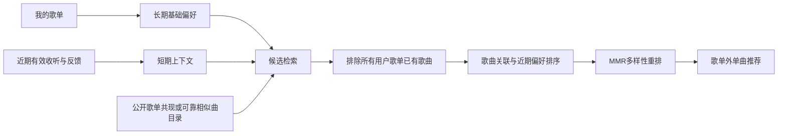

# LX推荐算法调研与升级选型

更新日期：2026-10-16。「软件推荐」已更名为「LX推荐」。本轮修正单首参考歌影响过大的问题：统一每批最多带出2首，降低单张公开歌单的关联置信度，校验本次查询的具体歌曲，并轮换参考歌。此前的公开曲库样本记录保留在下方；AI升级见单独说明，本次未改动AI流程。

## 1. 选型结论

软件推荐已升级为「多路候选召回 → 近期收听排序 → 多样性重排」。本次先落地轻量歌曲关联和短期上下文，再用真实反馈评测决定是否引入训练模型。

推荐组合是：Item-KNN / 加权共现关联 + 长短期偏好融合 + MMR。学习大型平台的流程与反馈建模，模型规模按本地单用户的数据条件选择。

## 2. 能核对的平台资料

| 公开资料 | 能借鉴的内容 | 对本软件的意义 |
| --- | --- | --- |
| [QQ 音乐技术团队的公开文章](https://cloud.tencent.com/developer/article/2230320) | 行为与画像、邻域关联；切歌需结合发生时机判断 | 快跳、听到大半后切歌分别处理 |
| [腾讯音乐参与的音频推荐研究，ICASSP 2021](https://www.2021.ieeeicassp.org/2021.ieeeicassp.org/Papers/ViewPaperfe40.html?PaperNum=2229) | 结合收听与音频表征处理新曲推荐 | 真正的声音相似性需要音频特征 |
| [网易云 Climber，2025](https://arxiv.org/abs/2502.09888) | 多尺度序列与多行为建模 | 分开处理近期方向和长期偏好 |
| [网易云 Climber-Pilot，2026](https://arxiv.org/abs/2602.13581) | 时间感知的多物品预测、约束下的生成式召回 | 关注后续一组歌曲及约束，避免只追逐下一次点击 |

这些是公开文章和研究，不是 QQ、网易云 2026 年完整线上代码或全部入口的配方。论文报告的业务收益也不能直接换算成本软件的效果。

## 3. 开源项目比较

| 项目 | 已核对的能力 | 本项目的使用位置 |
| --- | --- | --- |
| [Implicit](https://github.com/benfred/implicit) | ALS、BPR，以及 Cosine / TF-IDF / BM25 的 Item-Item 邻居；有音乐示例 | 首选参考轻量关联计算 |
| [session-rec](https://github.com/rn5l/session-rec) | 会话推荐评测与邻居模型，包含近期位置与时间权重 | 参考短期上下文及评测方法 |
| [RecBole](https://github.com/RUCAIBox/RecBole) | PyTorch 推荐评测框架；包含 SASRec 等模型 | 开发阶段对比基线与序列模型 |
| [Meta Generative Recommenders](https://github.com/meta-recsys/generative-recommenders) | HSTU 等生成式推荐实现 | 前沿研究对照，当前不放入桌面运行依赖 |

核对时 Implicit 约 3.8k stars，RecBole 约 4.6k stars，数字仅说明项目关注度。Meta 官方公开实验说明提到约 24GB 显存的 GPU 配置，不能视为普通桌面后台任务的资源预算。

这些库并不自带与 QQ、网易云、B站目录对应的完整音乐关联知识。把框架装进播放器，不会自动获得大型平台积累的用户行为、音频向量和音乐目录映射。

## 4. 升级前的主要瓶颈

升级前核对了 `softwareProfile.ts` 与 `softwareEngine.ts`：

- 画像已经能利用完播、反复播放、时长和快跳，按最近 30 天、7 天半衰期计算。
- 近期行为逐渐取得主要权重，但当前主要汇总到歌手层级。
- 候选主要来自少数偏好歌手的歌曲搜索，每个平台最多两次；第一页没有合格结果时再看第二页。
- 排序主要依赖歌手偏好和重复歌手惩罚。同一歌手不同歌曲之间的关联依据还很少。
- 既有歌单排除、跨平台匹配、取消、缓存与播放流程可以复用。

本轮据此先扩大有依据的候选来源，再改善排序。单纯加深原有打分模型，不能弥补候选库里根本没有合适歌曲的问题。

## 5. 已接入的推荐流程

### 5.1 多路召回，解决新歌从哪里来

并行或按预算调度以下候选通道，保留来源和关联证据：

1. **歌曲关联**：从近期有效收听和累积偏好中选择最多四首代表歌曲（贴近喜好最多三首），优先覆盖不同歌手。在最多12个真实偏好方向之间轮换，保留一个当前收听方向；冷启动抽样覆盖参考歌曲集合的不同位置，小歌手集合每位最多两首不同歌曲。每首先检查一张公开歌单，未找到该歌曲的方向优先尝试第二张，再补已有方向的上下文。
2. **公开歌单共现**：在有重叠代表曲目的公开歌单中寻找其他歌曲，让其他歌手进入候选。公开歌单是共同编排的上下文，不等同于真实的多用户收听数据。
3. **已有歌手通道**：保留当前搜索作为稳定补充，避免关联接口失败后完全无法推荐。
4. **跨曲库确认**：网易云关联候选可以直接使用；选择 QQ 或 B站时，用歌名和歌手检索对应平台，只有名称、歌手及可用的时长相符才转入候选。不凭检索结果的位置认定为同一首歌。

公共歌单必须验证与代表歌曲的实际重叠，不能仅凭歌单标题含某个歌手就把整张列表判为相关。限制单张歌单贡献、相似副本和热门歌曲的影响，关联证据少时降低置信度。

`softwareCatalogue.ts` 已独立接入网易云匿名公开接口：`/api/search/get/web` 的歌单搜索、`/api/v6/playlist/detail` 的详情，以及必要时一次 `/api/song/detail` 的曲目信息补充。实测某些匿名详情只返回 10 首，补充上限为 100 个 ID；不为了遍历大歌单持续翻页，不读取账号 Cookie，不调用每日推荐或 SDK 中带多次重试的详情函数。

每个代表曲最多检查两张歌单。上下文必须包含本次查询的那首代表曲，而非任意另一首已知歌曲；不匹配的第一张不会挤掉该方向的第二次尝试。最终最多保留四张合格上下文，所有详情尝试共用原有请求预算。同名翻唱、不同歌手或无法确认的元数据都不会被当作原曲关联。候选基于返回的有限曲目，不声称取得整张歌单或完整平台关联图。当前尚未使用风格、语言标签，也未分析音频。

### 5.2 Item-KNN / 共现关联

`softwareAssociations.ts` 在本轮最多四张经过核对的公开歌单中建立稀疏歌曲关系，采用加权共现余弦、支持度收缩与代表歌曲偏好融合。大歌单降权；歌曲集合 Jaccard 相似度达到 0.85 的副本只算一份；上下文中的快跳歌曲进一步降低关系权重。过弱关联不单独启动跨曲库检索。

这是对邻居方法的本地适配方案，具体实现不直接宣称与 Implicit 的 BM25 模型相同。若只有用户自己的少数歌单，关联图里的歌曲基本都已属于用户歌单，不能靠这个图独立完成发现新歌。

这是一轮少量公开上下文内的 Item-KNN 思路适配，不是从全平台行为训练出的协同过滤模型。只维护有证据的少量边，不构造全曲库稠密矩阵，不训练单个用户的 ALS。后续如取得可映射的公共音乐交互数据，再比较 ALS、BPR 或图模型。

### 5.3 近期听歌序列

`softwareProfile.ts` 在原来的 30 天汇总之外，增加最近 24 小时内、最新一段连续听歌中的最多 12 次有效收听。相邻有效记录间隔超过 45 分钟时分段，按位置指数衰减和 4 小时时间半衰期加权；单曲循环最多贡献两次。这里的「听歌时段」跨多首歌曲，区别于统计表的一行单曲播放会话。

- 最近完整听完、反复听的歌曲优先；时长是补充信号。
- 区分今天刚转向的兴趣与一个月积累的喜好。
- 连续快跳降低对应候选关系；失败、缓冲和未播放的曝光不计为不喜欢。
- 阈值和融合权重通过实际数据评测，不硬称某个固定比例最优。

当前用位置、时间加权的上下文调整代表曲、检索方向和候选相关性；过旧上下文不会占用最新方向的检索位置。阈值是可调整的工程参数。取得足够的多会话语料后，再比较 session-KNN 或 SASRec；当前没有部署这些训练模型。

### 5.4 MMR 多样性重排

`softwareMmr.ts` 在相关性合格的候选中，按 `λ × 相关性 − (1−λ) × 与已选歌曲的最大相似度` 选择下一首。相似度使用可靠歌手、专辑 ID、同歌手专辑名、常见版本标记，以及已核对的公开歌单共同出现关系；空歌手、空专辑和默认专辑 ID 不视为相同。

[MMR 原论文](https://www.cs.cmu.edu/~jgc/publication/The_Use_MMR_Diversity_Based_LTMIR_1998.pdf)提供了相关性与新颖性的折中形式；用于音乐时，相似度来源和参数需要本项目验证。没有音频向量时，不声称能够比较声音听感。

「贴近喜好 / 均衡 / 探索」同时调节检索通道和重排：MMR 的 λ 分别为 0.86 / 0.68 / 0.5；贴近模式最多查三首代表曲、三张公开歌单，最多解析两首跨曲库关联；均衡与探索最多检查四张歌单，跨曲库解析上限分别为六首、八首。单一曲库下，贴近与均衡最多检索四位偏好歌手，探索最多两位；全部曲库时将检索方向分散到各平台。优先检索其他代表歌手，没有其他方向或各方向均无新歌时再在预算内查第二页。总队列仍受 22 个检索操作限制。

为修正「不同歌手却都来自同一首代表歌」的集中问题，关联候选现在保留多个真实锚点及其支持强度。跨曲库解析按锚点和歌手共同分配名额；MMR 增加累计锚点惩罚，并优先让首屏覆盖不同的合格方向。只有确实共同出现且支持度足够的关系才能用于理由，不随机替换推荐依据。

`selectSoftwareBatch` 在所有探索档位、首次展示和换一批时都执行同一规则：每首参考歌每批最多带出2首，即使只有一个方向也不解除上限。歌手搜索和公开歌单关联结果共享该参考歌的配额，不能通过更换理由或通道绕过。同一张公开歌单的合计贡献另受限制：均衡最多5首，贴近6首，探索4首。超额候选保留供后续批次，候选不足则显示实际数量；更新时排除近期已展示歌曲，成功更新才推进轮换游标。所有模式继续排除全部用户歌单的已有歌曲。

单个公开歌单的关联置信度由原来的平方根快速饱和改为连续收缩 `score / (score + 0.25)`，避免一次共现获得接近满额的关联加分。候选如果也来自对偏好歌手的真实直接检索，会保留该收听偏好依据和原始参考歌，不被共现理由全部覆盖。公开歌单标识与参考歌身份随结果保存，以保证重启后仍能执行配额。

## 6. 当前验证及后续效果评测

当前全量163项回归检查通过。本轮新增覆盖：所有档位的每首参考歌两首上限、单方向不解除上限、歌手搜索与关联结果共用配额、同一公开歌单的合计贡献、强弱方向混排、参考歌轮换、具体查询歌曲核验、相同歌单请求合并、直接检索依据保留，以及单次共现不过度加分。还验证v4到v5迁移、轮换状态持久化、失败不推进轮换、更新排除已展示歌曲。界面TypeScript、两种模式的Vue脚本类型/模板/Less编译、相关ESLint和三种语言名称检查通过。上述约束使用隔离数据验证，未自动播放、写入人工收听记录或调用付费模型。

以下为本轮进一步分散参考歌之前的开发版公开样本记录，不能作为“两首上限”规则的当前结果。测试使用独立的公开歌曲样本「陈奕迅－红玫瑰」调用真实引擎，没有修改用户歌单或收听记录，也没有播放或切换音乐：

| 场景 | 生成阶段请求数 | 结果 | 检查结论 |
| --- | --- | --- | --- |
| 网易云，公开歌单缓存为空 | 6 | 60 首候选 | 出现张宇、周传雄、刘若英、蔡健雅等其他歌手；已有歌曲重合 0 |
| 全部曲库，公开歌单缓存命中 | 9 | 60 首，QQ 6、网易云 54 | 去重后同一录音不按平台重复展示，曲目信息均通过结构检查 |
| B站，公开歌单缓存命中 | 7 | 10 首，其中 6 首有明确歌曲关联 | 取得 B站对应视频，而非把网易云 ID 当作 B站歌曲 |

网易云单次样本的首批结果约 252ms、生成结束约 951ms；这是当时网络下的一次检查，不是延迟保证。以上请求统计不含事先准备公开代表曲的查询、封面图片和 B站首次获取的游客身份。候选检索不预取音频或验证播放地址；公开歌单覆盖不足、B站标题与歌手不明确时仍会减少关联结果，并使用普通搜索补充。

后续使用当前本地偏好检查 QQ 模式：返回 45 首候选，展示 20 首，前四首来自四个方向；本批六个方向的数量为 5、5、5、2、2、1，单条可见推荐理由最多重复四次，已有歌曲重合为 0。仅手动更新推荐，没有播放、切歌或生成收听记录。界面同时去掉重复标题、算法段落、收听状态说明、更新时间与底部说明，采用紧凑筛选区和通常两列的歌曲卡片。

后续保留升级前版本作为基线，使用时间顺序切分数据，先用过去行为生成候选，再评估后续真实行为，防止把未来结果泄漏给模型。

分别报告：

- **候选覆盖**：后续真正喜欢的歌是否进过候选；这一项能定位召回问题。
- **排序表现**：统一候选和负样本条件下的 Recall@20、NDCG@20。
- **实际体验**：有效收听、完播、重复收听、主动快跳，以及加入用户歌单的比例。
- **发现与质量**：歌单已有歌曲重合应为零；歌手覆盖、重复版本、非歌曲或短片段比例单独统计。
- **资源**：请求次数、缓存命中、首批结果延迟和峰值内存。

本机新增记录尚少时，先做算法正确性与覆盖检查，不输出缺乏样本支撑的准确率提升百分比。未点击的推荐不能自动当作负样本；如要评价推荐曝光效果，需补充少量本地曝光记录。

## 7. 运行与落地边界

- 本轮只调整LX推荐；AI入口沿用上轮已实现的独立生成流程。
- 推荐计算在本机，发现新歌仍需要公开曲库与关联数据接口，不需要大语言模型 API。
- 关联数据按需获取、有容量与时效限制；点击更新时调度，后台不持续扫描或轮询。
- `softwareRequests.ts` 让歌手检索、公开歌单读取和跨曲库解析共用并发 2 的队列；一轮最多 22 个检索操作，30 秒后停止启动新操作，在途请求按各自 8～12 秒超时或用户取消结束。B站游客身份仍复用原有的内存共享请求，首次可能多一次。
- 歌单缓存只保留16张、每张最多100首规范曲目元数据，搜索缓存32项，6小时后按需过期；不存音频、歌词或账号凭据。推荐结果缓存升级为v5，保留旧版筛选偏好并重新生成候选；只额外保存规范化推荐方向、参考歌、最多四个公开上下文标识和有限轮换计数，以便换一批和重启后继续控制集中度。
- 初期采用 CPU 可处理的稀疏邻居索引；大型模型放在开发阶段评测，验证收益后才考虑导出轻量服务或索引。
- 不能直接使用电影等其他领域数据集的模型权重给音乐目录推荐；音乐数据必须先解决身份映射和覆盖。

关联候选、近期上下文和 MMR 已接入。本次确认了候选能够扩展到其他歌手、筛选和预算机制正确；个人推荐准确率仍需更多后续真实反馈评估，不用单个样本推出准确率提升比例。
